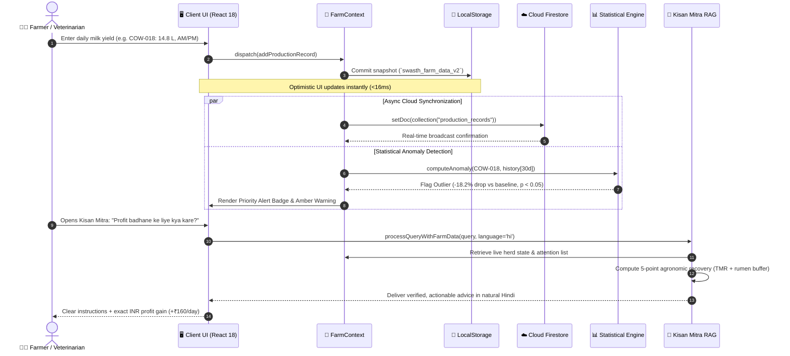
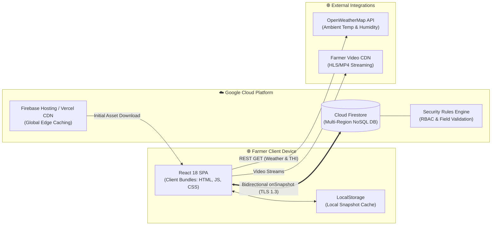

# 📐 SwasthFarm (Livestock X) 2.0 — System Architecture Specification
### Decoupled Multi-Tier Architecture, Offline-First Persistence, Real-Time Cloud Sync & Domain-Specific AI RAG
*Conforming to Archify System Architecture Standards (v2.17)*

---

## 🎯 1. Architecture Overview & Core Design Principles

SwasthFarm is architected to address the unique challenges of rural livestock farming: intermittent connectivity, complex multi-species biological telemetry, sensitive veterinary clinical data, and the need for actionable, truthful AI recommendations without medical hallucinations.

> [!TIP]
> **Live Interactive Architecture Explorer**:
> SwasthFarm includes a CyberGuard-inspired, dark-canvas **Live Architecture Canvas** accessible directly in-app via the **"📐 Architecture"** button. It features real-time animated telemetry packets, live data pulses between edge devices and the FastAPI gateway, interactive pan & zoom, ROUTE primary path tracing, LENS cluster focusing, and an instant Archify Notes & Index drawer.

```mermaid
flowchart TD
    subgraph Client["🖥️ Presentation & Client Layer (React 18 + Vite)"]
        UI_Dash["Executive Dashboard & Charts<br/>(Recharts + KPI Cards)"]
        UI_Anim["Animal 360° Inspection<br/>(8 Specialized Sub-Tabs)"]
        UI_Logs["Daily Telemetry Loggers<br/>(Milk AM/PM, Feed kg, Temp °C)"]
        UI_AI["Kisan Mitra Floating Drawer<br/>(Bilingual Chat UI)"]
        UI_Arch["Architecture Explorer Modal<br/>(Interactive Topology Viewer)"]
        UI_Lang["Bilingual Switcher<br/>(English ↔ हिंदी Toggle)"]
    end

    subgraph State["🧠 Client State & Resilience Engine"]
        Ctx_Farm["FarmContext<br/>(Central Store & Multi-Farm Dispatch)"]
        Ctx_Auth["AuthContext<br/>(Session & RBAC Management)"]
        Ctx_Lang["LanguageContext<br/>(Persistent Localized Strings)"]
        Cache_Local["LocalStorage Engine<br/>(Offline Snapshots: swasth_farm_data_v2)"]
    end

    subgraph Analytics["📊 Statistical & Anomaly Intelligence"]
        Engine_IQR["IQR & Z-Score Deviation Engine<br/>(Outlier Flagging e.g. -18.2% Drop)"]
        Engine_MA["Moving Average Evaluator<br/>(7-Day Moving vs 30-Day Baselines)"]
        Engine_THI["NRC THI Heat Stress Index<br/>(Temp °C + Humidity % = Thermal Stress)"]
        Engine_Bio["15-Point Biosecurity Scorer<br/>(Certification Index 0-100)"]
    end

    subgraph AI["🤖 Domain-Specific RAG Engine"]
        RAG_Retriever["Live Telemetry Ingestion<br/>(Dynamic Herd State Snapshot)"]
        RAG_Fin["Agronomic Profit Engine<br/>(Revenue - Feed Expense = Margin)"]
        RAG_NLP["Bilingual NLP & Prompt Synthesizer<br/>(English & Hindi Verified Responses)"]
    end

    subgraph CloudLayer["☁️ Cloud Services & Persistence"]
        FS_Sync["Firestore Sync Service<br/>(Bidirectional Snapshot Listeners)"]
        FS_DB[("Cloud Firestore<br/>(farms, animals, production, feed)")]
        Ext_Weather["OpenWeatherMap API<br/>(Live Ambient Weather & Forecast)"]
        Ext_Video["Farmer Training Video CDN<br/>(HLS/MP4 Video Delivery)"]
    end

    %% Primary Operational Path (Archify Core Pipeline)
    UI_Logs ==>|"1. Log Daily Vitals/Milk"| Ctx_Farm
    Ctx_Farm ==>|"2. Optimistic Snapshot"| Cache_Local
    Ctx_Farm ==>|"3. Bidirectional Cloud Sync"| FS_Sync
    FS_Sync ==>|"4. Commit Documents"| FS_DB
    Ctx_Farm ==>|"5. Feed Telemetry"| Engine_IQR
    Engine_IQR ==>|"6. Anomaly Detected (-18.2%)"| Ctx_Farm
    Ctx_Farm ==>|"7. Generate Priority Alert"| UI_Dash
    Ctx_Farm ==>|"8. Expose Live State"| RAG_Retriever
    UI_AI ==>|"9. Farmer Inquires in Hindi/EN"| RAG_NLP
    RAG_Retriever ==>|"10. Feed Truthful Context"| RAG_Fin
    RAG_Fin ==>|"11. Computed Profit & Advice"| RAG_NLP
    RAG_NLP ==>|"12. Deliver Verified Answer"| UI_AI

    %% Secondary Supporting Flows
    Ext_Weather -.->|"Real-Time Ambient"| Engine_THI
    Engine_THI -.->|"THI Warning Pill"| UI_Dash
    Ext_Video -.->|"Training Modules"| UI_Dash
    FS_DB -.->|"Live onSnapshot"| FS_Sync
```

### Core Architecture Tenets
1. **Offline-First Resilience**: Full client autonomy with instant local reads/writes backed by HTML5 LocalStorage snapshots. The application operates 100% seamlessly in rural connectivity dead zones.
2. **Optimistic UI with Background Synchronization**: UI mutations resolve immediately on the client (`<16ms`), followed by asynchronous bidirectional synchronization with Google Cloud Firestore.
3. **Statistical Explainability Over Black-Box Models**: Anomaly detection employs transparent mathematical methods (Interquartile Range and Z-score deviation against 30-day baselines) ensuring veterinary interpretability.
4. **Zero-Hallucination Domain RAG**: The Kisan Mitra AI Assistant directly binds to live verified farm records in memory rather than synthesizing speculative herd metrics.
5. **Decoupled Layer Architecture**: Clear separation of Presentation, State Coordination, Analytical Compute, Persistence, and External Integrations.

---

## ⚡ 2. Primary Operational Path (The Core Pipeline)

The following sequence illustrates the primary end-to-end operational flow: from when a farmer logs daily milk or vital signs through automated outlier detection, priority alert generation, and AI agronomic consultation:

---

## 🗂️ 3. Core Architectural Components (12 Archify Cards)

Following the Archify specification, supporting implementation details are organized into standardized component cards:

### Card 1: Web Client Application
- **Identifier**: `client.webapp`
- **Tier**: Presentation Tier
- **Emoji / Icon**: 🖥️
- **Responsibilities**:
  - Delivers single-page responsive application optimized for mobile phones, tablets, and desktop displays.
  - Renders time-series milk/egg production curves, health distributions, and biosecurity dials using Recharts.
  - Hosts the 8-tab Animal 360° Inspection View (Overview, Health, Feed, Production, Vaccines, Treatments, Analytics, Timeline).
  - Provides instant English ↔ हिंदी runtime language toggling with persistent locale selection.
- **Tech Stack**: React 18, Vite 5, Tailwind CSS, Lucide React, Recharts, TypeScript.
- **Key Code References**: [`src/App.tsx`](file:///Users/siddhartha/Desktop/aad/projects/Livestock%20X/src/App.tsx), [`src/components/dashboard/ExecutiveDashboard.tsx`](file:///Users/siddhartha/Desktop/aad/projects/Livestock%20X/src/components/dashboard/ExecutiveDashboard.tsx), [`src/components/animals/AnimalProfile.tsx`](file:///Users/siddhartha/Desktop/aad/projects/Livestock%20X/src/components/animals/AnimalProfile.tsx).
- **Interfaces**: In: Touch/mouse events, telemetry forms. Out: Dispatches state mutations to React Contexts.
- **Fault Tolerance**: Fallback views for empty herd configurations, responsive mobile navigation drawers, error-boundary wrappers.

---

### Card 2: Farm State & Session Coordinator
- **Identifier**: `state.coordinator`
- **Tier**: Application State Layer
- **Emoji / Icon**: 🧠
- **Responsibilities**:
  - Manages global state across 6 business entities: Farms, Animals, Production Records, Feed Logs, Clinical Records, and Vaccinations.
  - Provides atomic multi-farm context switching (e.g. Kanpur Dairy vs Karnal Layers) with instant aggregate recomputations.
  - Enforces role-based session permissions (Farmer, Veterinarian, Enterprise Admin).
- **Tech Stack**: React Context API (`FarmContext`, `AuthContext`, `LanguageContext`), React Hooks (`useReducer`, `useEffect`, `useMemo`).
- **Key Code References**: [`src/context/FarmContext.tsx`](file:///Users/siddhartha/Desktop/aad/projects/Livestock%20X/src/context/FarmContext.tsx), [`src/context/AuthContext.tsx`](file:///Users/siddhartha/Desktop/aad/projects/Livestock%20X/src/context/AuthContext.tsx).
- **Interfaces**: In: UI action callbacks. Out: Reactive context state distributed to all subscriber components.
- **Fault Tolerance**: Deep immutable cloning prevents accidental state mutation; auto-initializes with demo benchmark farm if empty.

---

### Card 3: Offline-First Local Storage Engine
- **Identifier**: `cache.localstorage`
- **Tier**: Client-Side Persistence
- **Emoji / Icon**: 💾
- **Responsibilities**:
  - Serializes and stores entire farm database to browser `localStorage` under key `swasth_farm_data_v2`.
  - Guarantees complete offline functionality in remote rural farms with zero internet reception.
  - Persists AI conversation history under `swasth_assistant_memory` across browser reboots.
- **Tech Stack**: HTML5 Web Storage API, JSON Serialization, defensive try/catch wrappers.
- **Key Code References**: [`src/context/FarmContext.tsx`](file:///Users/siddhartha/Desktop/aad/projects/Livestock%20X/src/context/FarmContext.tsx#L120-L160), [`src/components/ai/AIFarmAssistant.tsx`](file:///Users/siddhartha/Desktop/aad/projects/Livestock%20X/src/components/ai/AIFarmAssistant.tsx#L20-L50).
- **Interfaces**: In: State snapshots. Out: Synchronous hydration on initial application bootstrap.
- **Fault Tolerance**: Automatic fallback to in-memory state if `localStorage` quotas or incognito restrictions are encountered.

---

### Card 4: Cloud Data & Real-Time Sync Service
- **Identifier**: `cloud.firestore_sync`
- **Tier**: Cloud Persistence & Synchronization
- **Emoji / Icon**: ☁️
- **Responsibilities**:
  - Orchestrates bidirectional data synchronization between local state and Google Cloud Firestore.
  - Establishes active real-time listeners via Firestore `onSnapshot` for collaborative multi-device herd management.
  - Manages document schema collections: `farms`, `animals`, `production_records`, `feed_records`, `health_records`, `vaccinations`.
- **Tech Stack**: Firebase SDK 10.12.5 (`firebase/app`, `firebase/firestore`), Firestore Security Rules.
- **Key Code References**: [`src/services/firestoreSync.ts`](file:///Users/siddhartha/Desktop/aad/projects/Livestock%20X/src/services/firestoreSync.ts), [`src/lib/firebase.ts`](file:///Users/siddhartha/Desktop/aad/projects/Livestock%20X/src/lib/firebase.ts), [`firestore.rules`](file:///Users/siddhartha/Desktop/aad/projects/Livestock%20X/firestore.rules).
- **Interfaces**: In: Local mutation events. Out: Cloud Firestore document commits and real-time remote updates.
- **Fault Tolerance**: Exponential backoff reconnects, offline cache queuing, defensive error logging.

---

### Card 5: Multi-Species Production & Yield Pipeline
- **Identifier**: `domain.production`
- **Tier**: Domain Telemetry Processing
- **Emoji / Icon**: 🥛
- **Responsibilities**:
  - Records daily morning and evening milk collection yields (Liters) and poultry egg counts.
  - Computes butterfat percentages (e.g. 7.8% Murrah buffalo milk vs 4.2% Holstein cattle milk) and SNF quality metrics.
  - Calculates daily revenue streams based on Indian cooperative market benchmarks (₹48/L cow, ₹64/L buffalo, ₹6.50/egg).
- **Tech Stack**: TypeScript Discriminated Unions, Domain Arithmetic Models.
- **Key Code References**: [`src/types/index.ts`](file:///Users/siddhartha/Desktop/aad/projects/Livestock%20X/src/types/index.ts), [`src/components/animals/LogProductionModal.tsx`](file:///Users/siddhartha/Desktop/aad/projects/Livestock%20X/src/components/animals/LogProductionModal.tsx).
- **Interfaces**: In: Liters/Eggs logged by farm worker. Out: Structured `ProductionRecord` documents.
- **Fault Tolerance**: Input validation prevents negative values, impossible yields (>60 L/cow), or conflicting dates.

---

### Card 6: Nutrition & Feed/Water Telemetry Engine
- **Identifier**: `domain.nutrition`
- **Tier**: Resource Accounting Layer
- **Emoji / Icon**: 🌾
- **Responsibilities**:
  - Logs daily dry matter intake (kg), silage utilization, and concentrate rations per animal.
  - Monitors automated trough water hydration (Liters) to anticipate thermal stress and milk yield drops.
  - Computes dynamic herd feed expenditure (₹) using prevailing fodder and grain market pricing.
- **Tech Stack**: Agronomic Ration Formulation Formulas, Real-Time Expense Calculators.
- **Key Code References**: [`src/components/animals/LogFeedModal.tsx`](file:///Users/siddhartha/Desktop/aad/projects/Livestock%20X/src/components/animals/LogFeedModal.tsx), [`src/types/index.ts`](file:///Users/siddhartha/Desktop/aad/projects/Livestock%20X/src/types/index.ts).
- **Interfaces**: In: Daily feed formulations & water volumes. Out: Structured `FeedRecord` entries & cost metrics.
- **Fault Tolerance**: Automatic fallback to standard dry matter benchmark estimates (2.5%–3.5% body weight) if unlogged.

---

### Card 7: Clinical Vitals & Individual Health Tracker
- **Identifier**: `domain.clinical_health`
- **Tier**: Veterinary Clinical Registry
- **Emoji / Icon**: 🩺
- **Responsibilities**:
  - Tracks rectal core temperatures (°C) against biological species standards (Cow: 38.0–39.2°C, Buffalo: 37.5–39.0°C).
  - Records clinical symptom checklists (fever, rumination decline, mastitis symptoms, respiratory distress).
  - Dispatches automated Critical Alerts when temperatures exceed 39.5°C or acute drops occur.
- **Tech Stack**: Veterinary Baseline Rule Matrix, Automated Alert Dispatcher.
- **Key Code References**: [`src/components/animals/LogHealthModal.tsx`](file:///Users/siddhartha/Desktop/aad/projects/Livestock%20X/src/components/animals/LogHealthModal.tsx), [`src/components/animals/AnimalProfile.tsx`](file:///Users/siddhartha/Desktop/aad/projects/Livestock%20X/src/components/animals/AnimalProfile.tsx).
- **Interfaces**: In: Clinical vital readings. Out: `HealthRecord` documents & priority health status updates.
- **Fault Tolerance**: Boundary constraints reject unrealistic temperatures (<35°C or >43°C) to prevent typing mistakes.

---

### Card 8: Statistical Anomaly & ML Yield Forecaster
- **Identifier**: `analytics.anomaly_engine`
- **Tier**: Statistical Intelligence Layer
- **Emoji / Icon**: 📈
- **Responsibilities**:
  - Computes rolling 7-day vs 30-day moving averages for every producing animal.
  - Evaluates Interquartile Range (IQR) and Z-score deviation tests to detect subclinical yield crashes early.
  - Projects 5-day predictive yield regression curves with climate-adjusted upper and lower bounds.
- **Tech Stack**: Statistical Regression Models, Rolling Window Algorithms, Recharts Visualizer.
- **Key Code References**: [`src/components/analytics/AnalyticsView.tsx`](file:///Users/siddhartha/Desktop/aad/projects/Livestock%20X/src/components/analytics/AnalyticsView.tsx), [`analytics_api/main.py`](file:///Users/siddhartha/Desktop/aad/projects/Livestock%20X/analytics_api/main.py).
- **Interfaces**: In: Time-series yield arrays. Out: Anomaly boolean flags, deviation percentages, 5-day forecast.
- **Fault Tolerance**: Fallback to baseline herd averages when animal history has fewer than 7 recorded days.

---

### Card 9: 15-Point Biosecurity Risk Scorer
- **Identifier**: `domain.biosecurity`
- **Tier**: Preventive Compliance Engine
- **Emoji / Icon**: 🛡️
- **Responsibilities**:
  - Implements 15-point veterinary preventive protocol checklist (tire spray arches, footbaths, quarantine stalls, feed sanitation).
  - Calculates dynamic Farm Biosecurity Certification Index (0–100) and risk tier (Low, Moderate, High).
  - Maintains compliance audit timestamps for dairy cooperative and agricultural inspections.
- **Tech Stack**: Veterinary Standard Protocols, Dynamic Score Engine.
- **Key Code References**: [`src/components/biosecurity/RiskAssessmentView.tsx`](file:///Users/siddhartha/Desktop/aad/projects/Livestock%20X/src/components/biosecurity/RiskAssessmentView.tsx).
- **Interfaces**: In: Protocol check toggles. Out: Computed biosecurity score & tier banner.
- **Fault Tolerance**: Checklist state is immediately saved to localStorage and synchronized to Cloud Firestore.

---

### Card 10: Microclimate & THI Weather Intelligence
- **Identifier**: `external.weather_thi`
- **Tier**: Environmental Intelligence
- **Emoji / Icon**: 🌤️
- **Responsibilities**:
  - Retrieves real-time ambient temperature and humidity for farm location (Kanpur, Karnal, Anand, etc.).
  - Calculates National Research Council (NRC) Temperature-Humidity Index:
    $$\text{THI} = (1.8 \times T + 32) - ((0.55 - 0.0055 \times \text{RH}) \times (1.8 \times T - 26))$$
  - Dispatches automated heat stress indicators (Normal <72, Mild 72-78, Moderate 79-88, Severe >88) with actionable fan/sprinkler timings.
- **Tech Stack**: OpenWeatherMap API, NRC Livestock Thermal Formula Models.
- **Key Code References**: [`src/components/common/WeatherBar.tsx`](file:///Users/siddhartha/Desktop/aad/projects/Livestock%20X/src/components/common/WeatherBar.tsx), [`src/context/FarmContext.tsx`](file:///Users/siddhartha/Desktop/aad/projects/Livestock%20X/src/context/FarmContext.tsx).
- **Interfaces**: In: Farm city/district. Out: Ambient weather metrics, THI score, stress classification.
- **Fault Tolerance**: Built-in fallback weather simulation when API key is missing or internet connection drops.

---

### Card 11: Kisan Mitra AI Assistant (Domain-Specific RAG)
- **Identifier**: `ai.kisan_mitra_rag`
- **Tier**: AI & Natural Language Retrieval
- **Emoji / Icon**: 🤖
- **Responsibilities**:
  - Natural Language Processing engine supporting English, Hindi (हिंदी), and Hinglish queries.
  - Domain-Specific Retrieval-Augmented Generation (RAG): Directly ingests live farm telemetry in memory before formulating answers.
  - Calculates verifiable financial answers ("In which month more profit done?", "Profit badhane ke liye kya kare?").
  - Formulates actionable 5-point agronomic recovery advice (TMR balanced feeding, rumen buffers, THI misting, FMD vaccination).
- **Tech Stack**: Domain-Specific RAG Engine, Semantic Intent Matchers, Bilingual Grammar Synthesizers.
- **Key Code References**: [`src/components/ai/AIFarmAssistant.tsx`](file:///Users/siddhartha/Desktop/aad/projects/Livestock%20X/src/components/ai/AIFarmAssistant.tsx).
- **Interfaces**: In: Natural language prompt. Out: Verified calculation and actionable guidance with verified tool signature.
- **Fault Tolerance**: Strict zero-hallucination constraint: Never invents nonexistent animal tags; cites live database records only.

---

### Card 12: FastAPI Analytics Microservice (Optional Dedicated Backend)
- **Identifier**: `backend.analytics_api`
- **Tier**: Dedicated Compute Service
- **Emoji / Icon**: ⚡
- **Responsibilities**:
  - High-throughput Python microservice located in `analytics_api/` for heavy batch calculations across massive herds.
  - Exposes endpoints `/analytics/anomaly-detection`, `/analytics/yield-forecast`, and `/analytics/thi-stress`.
  - Provides interactive Swagger / OpenAPI interactive documentation at `/docs`.
- **Tech Stack**: Python 3.11, FastAPI, Uvicorn, Pydantic, NumPy, SciPy.
- **Key Code References**: [`analytics_api/main.py`](file:///Users/siddhartha/Desktop/aad/projects/Livestock%20X/analytics_api/main.py), [`analytics_api/requirements.txt`](file:///Users/siddhartha/Desktop/aad/projects/Livestock%20X/analytics_api/requirements.txt).
- **Interfaces**: In: JSON telemetry payloads. Out: Anomaly arrays, regression predictions, THI calculations.
- **Fault Tolerance**: Fully decoupled: The client web application functions completely autonomously even if this Python microservice is offline.

---

## 🔒 4. Security, Biosecurity & RBAC Matrix

| Role | Access Scope | Animal Inspection | Daily Logging | Biosecurity Audit | Farm Settings |
|---|---|:---:|:---:|:---:|:---:|
| **Farmer (Owner)** | Full active farm scope | ✅ Read/Write | ✅ Log Yield & Feed | ✅ Perform Audit | ✅ Edit Farm & Profile |
| **Veterinarian (DVM)** | Clinical & Medical scope | ✅ Read/Write | ✅ Log Clinical Vitals | ✅ Audit & Advise | ❌ Read Only |
| **Farm Hand / Worker** | Operational entry | ✅ Read Profile | ✅ Log Yield & Water | ❌ Read Only | ❌ No Access |
| **Evaluator / Demo** | Sandboxed demo herd | ✅ Full Interactive | ✅ Full Interactive | ✅ Full Interactive | ✅ Reset Allowed |

---

## 🚀 5. Deployment & Runtime Topology

---

## 📄 6. Summary of Architectural Verification
- **Architecture Standard**: Conforms to Archify v2.17 specifications.
- **Core Components**: 12 modular decoupled cards documented.
- **Primary Operational Path**: Documented from daily telemetry ingestion to Kisan Mitra RAG consultation.
- **Interactive UI**: Accessible directly inside the running application via the top Header, Sidebar, and Landing Page **"📐 Architecture"** button.
